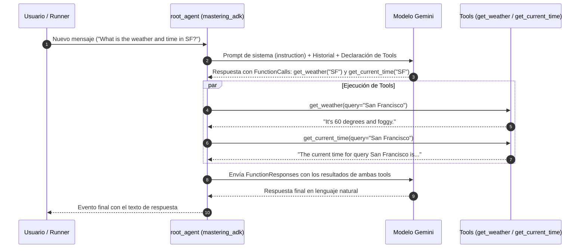

# 01 — El Núcleo del Agente (`app/agent.py` y `app/__init__.py`)

[⬅ Volver al índice de documentación](./README.md)

El archivo [`app/agent.py`](../app/agent.py) (re-exportado por [`app/__init__.py`](../app/__init__.py)) es el corazón funcional del proyecto. Acá se definen las **herramientas (tools)**, el **agente raíz (`root_agent`)** y la **aplicación ADK (`app`)**.

---

## 1. Flujo Interno de Ejecución del Agente

Cuando el `Runner` recibe un mensaje del usuario y lo pasa a [`root_agent`](../app/agent.py#L61-L73), ADK ejecuta un ciclo **ReAct (Reason + Act)** automático:



---

## 2. Definición de Herramientas (`Tools`)

En [`app/agent.py`](../app/agent.py#L28-L58) se definen dos funciones de Python estándar: [`get_weather`](../app/agent.py#L28-L39) y [`get_current_time`](../app/agent.py#L42-L58).

```python
def get_weather(query: str) -> str:
    """Simulates a web search. Use it get information on weather.

    Args:
        query: A string containing the location to get weather information for.

    Returns:
        A string with the simulated weather information for the queried location.
    """
    if "sf" in query.lower() or "san francisco" in query.lower():
        return "It's 60 degrees and foggy."
    return "It's 90 degrees and sunny."
```

### ¿Cómo convierte ADK una función Python en una Tool para Gemini?

Cuando pasás `tools=[get_weather, get_current_time]` al `Agent`, ADK las envuelve internamente en instancias de `FunctionTool` e inspecciona tres elementos clave:

1. **El nombre de la función (`get_weather`):** Es el identificador exacto que el modelo invocará en un `tool_call`.
2. **Los *type hints* (`query: str -> str`):** ADK los traduce al JSON Schema de parámetros que recibe Gemini. **Nunca omitas los tipos** en los parámetros de una tool.
3. **El *docstring*:** El modelo **no ve el código fuente** (`if "sf" in query.lower()...`), solo lee el docstring y la firma para decidir **cuándo** y **cómo** llamar a la función.

### Ejemplo Avanzado: Leer y escribir estado desde una Tool con `ToolContext`

Si agregás un parámetro llamado exactamente `tool_context: ToolContext` en la firma de cualquier herramienta, ADK **lo inyecta automáticamente** en tiempo de ejecución (y lo oculta del JSON Schema que ve el LLM):

```python
from google.adk.tools import ToolContext

def save_favorite_city(city: str, tool_context: ToolContext) -> dict:
    """Guarda la ciudad favorita del usuario en el estado de la sesión.

    Args:
        city: Nombre de la ciudad a recordar.
    """
    # Estado a nivel sesión (vive durante esta conversación)
    tool_context.state["favorite_city"] = city
    # Estado a nivel usuario (persiste entre distintas sesiones del mismo user_id)
    tool_context.state["user:default_city"] = city
    return {"status": "saved", "favorite_city": city}
```

---

## 3. Definición de `root_agent` ([`app/agent.py`](../app/agent.py#L61-L73))

```python
MODEL = "gemini-3.5-flash"

root_agent = Agent(
    name="mastering_adk",
    model=Gemini(
        model=MODEL,
        retry_options=types.HttpRetryOptions(attempts=3),
    ),
    instruction="You are a helpful AI assistant designed to provide accurate and useful information.",
    tools=[get_weather, get_current_time],
)
```

### Parámetros principales de `Agent` (`LlmAgent`)

| Parámetro | Valor en `app/agent.py` | Explicación |
|-----------|-------------------------|-------------|
| `name` | `"mastering_adk"` | Identificador único del agente. **Regla crítica:** debe coincidir con `create_params.root_agent_name` en [`agents-cli-manifest.yaml`](../agents-cli-manifest.yaml#L13) porque la telemetría OpenTelemetry etiqueta las trazas con `gen_ai.agent.name="mastering_adk"`. |
| `model` | `Gemini(model=MODEL, retry_options=...)` | Podés pasar un string directo (`"gemini-3.5-flash"`) o una instancia de `google.adk.models.Gemini` para configurar opciones de transporte como `HttpRetryOptions(attempts=3)` ante errores transitorios (`429 Too Many Requests` o `503`). |
| `instruction` | `"You are a helpful..."` | El *system prompt* del agente. Soporta interpolación dinámica de claves de `session.state` usando llaves, por ejemplo: `"El usuario prefiere respuestas en {preferred_language}."` |
| `tools` | `[get_weather, get_current_time]` | Lista de funciones Python, instancias de `BaseTool` (como `load_web_page`), `AgentTool` o `McpToolset`. |

### Opciones adicionales que podés agregar a `root_agent`

```python
from google.adk.agents import Agent
from google.adk.agents.callback_context import CallbackContext
from google.genai import types

async def init_state_callback(callback_context: CallbackContext) -> None:
    """Se ejecuta antes de cada turno del agente."""
    callback_context.state.setdefault("preferred_language", "Español")

root_agent = Agent(
    name="mastering_adk",
    model=Gemini(model=MODEL, retry_options=types.HttpRetryOptions(attempts=3)),
    description="Descripción usada cuando otro agente delega tareas a este agente.",
    instruction="Respondé siempre en {preferred_language}.",
    tools=[get_weather, get_current_time],
    sub_agents=[],                        # Sub-agentes para delegación dinámica
    output_key="last_answer",             # Guarda automáticamente la respuesta final en session.state["last_answer"]
    before_agent_callback=init_state_callback,
    generate_content_config=types.GenerateContentConfig(
        temperature=0.2,
    ),
)
```

---

## 4. El Contenedor `App` ([`app/agent.py`](../app/agent.py#L75-L78) y [`app/__init__.py`](../app/__init__.py))

Al final de [`app/agent.py`](../app/agent.py#L75-L78) se define el objeto `app`:

```python
app = App(
    root_agent=root_agent,
    name="app",
)
```

Y [`app/__init__.py`](../app/__init__.py#L15-L17) lo expone a nivel de paquete:

```python
from .agent import app

__all__ = ["app"]
```

### ¿Por qué existe `App` además de `root_agent`?

Mientras que `root_agent` define el comportamiento de un agente (o árbol de agentes), `App` representa la **aplicación desplegable completa**:

1. **Regla del nombre (`name="app"`):** El parámetro `name` de `App` **debe coincidir exactamente con el nombre del directorio del paquete Python (`app`)**. El CLI de ADK y el motor de evaluación (`agents-cli eval`) infieren el `app_name` a partir de la carpeta `app/`; si difieren, las sesiones creadas durante la evaluación fallan con `Session not found`.
2. **Configuración transversal:** En `App(...)` es donde se conectan políticas que aplican a todos los agentes y sub-agentes del proyecto:
   - `plugins=[...]` (por ejemplo, `ReflectAndRetryToolPlugin`, `LoggingPlugin` o `BigQueryAgentAnalyticsPlugin`).
   - `events_compaction_config=EventsCompactionConfig(...)` para resumir conversaciones largas cuando superan un umbral de tokens.
   - `context_cache_config=ContextCacheConfig(...)` para cachear prompts de sistema grandes en Gemini.

---

**Siguiente lectura recomendada:** [02 — El Servidor y las 3 Superficies de Entrada (`fast_api_app.py`)](./02-servidor-y-superficies-http.md)
