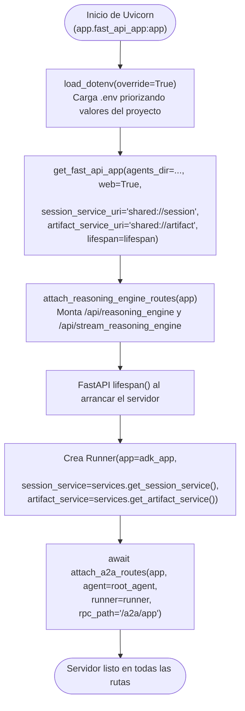
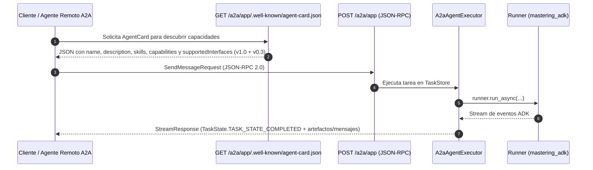

# 02 — El Servidor y las 3 Superficies de Entrada (`fast_api_app.py`, `a2a.py`, `reasoning_engine_adapter.py`)

[⬅ Volver al índice de documentación](./README.md) · [⬅ Anterior: 01 — El Núcleo del Agente](./01-nucleo-del-agente.md)

Uno de los mayores aportes del scaffold de `agents-cli` es su capa de servidor HTTP en [`app/fast_api_app.py`](../app/fast_api_app.py). En lugar de exponer únicamente la API de desarrollo de ADK, monta **tres protocolos de comunicación sobre el mismo proceso FastAPI**:

1. **Superficie 1 — API Nativa de ADK + Playground Web** (`/run`, `/run_sse`, `/apps/app/...`, `/dev-ui`)
2. **Superficie 2 — Protocolo A2A (Agent2Agent)** (`/a2a/app`, `/a2a/app/.well-known/agent-card.json`)
3. **Superficie 3 — Adaptador de Vertex AI Agent Runtime (`reasoning_engine`)** (`/api/reasoning_engine`, `/api/stream_reasoning_engine`)

---

## 1. Arquitectura de Inicialización del Servidor



En [`app/fast_api_app.py`](../app/fast_api_app.py#L31-L80):

- **Línea 31 (`load_dotenv(override=True)`):** Carga las variables de `.env` (como `GEMINI_API_KEY`) asegurándose de que tengan prioridad sobre cualquier variable heredada de la terminal.
- **Líneas 65–73 (`get_fast_api_app(...)`):** Construye la aplicación FastAPI base de ADK pasándole los URIs `shared://session` y `shared://artifact` (definidos en [`app/app_utils/services.py`](../app/app_utils/services.py#L31-L32)) y el context manager asíncrono [`lifespan`](../app/fast_api_app.py#L42-L62).

---

## 2. Superficie 1: API Nativa de ADK y Playground Web

Generada automáticamente por `google.adk.cli.fast_api.get_fast_api_app(..., web=True)` en [`app/fast_api_app.py`](../app/fast_api_app.py#L65-L73).

### ¿Qué rutas expone?

| Ruta HTTP | Método | Propósito |
|-----------|--------|-----------|
| `/` (o `/dev-ui`) | `GET` | Interfaz web interactiva (**ADK Playground**) para conversar con el agente, inspeccionar eventos, llamadas a tools y el diccionario `state`. |
| `/apps/{app_name}/users/{user_id}/sessions` | `POST` / `GET` | Crear o listar sesiones para un usuario, permitiendo inicializar `state` desde el arranque. |
| `/run` | `POST` | Ejecutar un turno del agente y recibir la lista completa de eventos en formato JSON al finalizar. |
| `/run_sse` | `POST` | Ejecutar un turno recibiendo los eventos en tiempo real vía **Server-Sent Events (SSE)**. Es el endpoint que usan `agents-cli playground`, `agents-cli run` y el test [`test_adk_run_sse`](../tests/integration/test_server_e2e.py#L130-L171). |

### Ejemplo de invocación por `/run_sse`

```python
import requests

# 1. Crear sesión con estado inicial
session = requests.post(
    "http://127.0.0.1:8000/apps/app/users/leo/sessions",
    json={"state": {"preferred_language": "Spanish"}},
).json()

# 2. Enviar mensaje por streaming SSE
resp = requests.post(
    "http://127.0.0.1:8000/run_sse",
    json={
        "app_name": "app",
        "user_id": "leo",
        "session_id": session["id"],
        "new_message": {"role": "user", "parts": [{"text": "What is the weather in SF?"}]},
        "streaming": True,
    },
    stream=True,
)
```

---

## 3. Superficie 2: Protocolo A2A (`app/app_utils/a2a.py`)

El protocolo [**A2A (Agent2Agent)**](https://a2a-protocol.org/) es el estándar abierto para que agentes construidos con distintos frameworks (ADK, LangGraph, CrewAI, etc.) puedan descubrirse entre sí y delegarse tareas por red.

El archivo [`app/app_utils/a2a.py`](../app/app_utils/a2a.py) se encarga de montar toda la superficie A2A sin que tengas que escribir código manual:



### Componentes clave de [`app/app_utils/a2a.py`](../app/app_utils/a2a.py)

1. **[`attach_a2a_routes`](../app/app_utils/a2a.py#L112-L163):**
   Se invoca dentro del [`lifespan`](../app/fast_api_app.py#L55-L61) de FastAPI porque [`AgentCardBuilder.build()`](../app/app_utils/a2a.py#L136-L141) es asíncrono. Inspecciona `root_agent` y sus tools para generar automáticamente la `AgentCard`.
2. **Compatibilidad dual A2A v1.0 + v0.3 ([`_add_v0_3_compat_interface`](../app/app_utils/a2a.py#L53-L68)):**
   Agrega la interfaz JSON-RPC `0.3` además de la `1.0` en `supportedInterfaces` y habilita `enable_v0_3_compat=True` en [`create_jsonrpc_routes`](../app/app_utils/a2a.py#L158-L162). Esto garantiza que tanto clientes A2A 1.0 como el registro de agentes en Gemini Enterprise (`agents-cli publish gemini`) puedan validar la tarjeta.
3. **Resolución inteligente de URL pública ([`_resolve_app_url`](../app/app_utils/a2a.py#L84-L110)):**
   Determina qué URL anunciar dentro del `agent-card.json` siguiendo este orden de prioridad:
   - El parámetro explícito `app_url` o la variable `APP_URL`.
   - En **Agent Runtime** (cuando existen `GOOGLE_CLOUD_AGENT_ENGINE_ID` y `GOOGLE_CLOUD_PROJECT`), construye automáticamente la URL del passthrough `/api` de Vertex AI (`https://{location}-aiplatform.googleapis.com/reasoningEngines/v1/.../api`).
   - En desarrollo local, usa `http://0.0.0.0:8000`.

---

## 4. Superficie 3: Adaptador de Agent Runtime (`app/app_utils/reasoning_engine_adapter.py`)

Cuando desplegás este contenedor en **Vertex AI Agent Runtime** (`deployment_target: "agent_runtime"`) o lo probás desde el playground de la consola de Google Cloud, la plataforma invoca al contenedor mediante un contrato específico: enviando peticiones `POST` a `/api/reasoning_engine` (sincrónico) o `/api/stream_reasoning_engine` (streaming) con el formato JSON:

```json
{
  "class_method": "async_stream_query",
  "input": {
    "user_id": "u-123",
    "message": "What is the weather in San Francisco?"
  }
}
```

### ¿Qué hace [`attach_reasoning_engine_routes`](../app/app_utils/reasoning_engine_adapter.py#L40-L113)?

1. Instancia de forma perezosa (*lazy*) un objeto `AdkApp` del paquete `agentplatform.agent_engines.templates.adk` ([`get_runtime`](../app/app_utils/reasoning_engine_adapter.py#L46-L67)), pasándole los mismos *builders* de servicios compartidos (`services.get_session_service` y `services.get_artifact_service`).
2. Obtiene la lista blanca de métodos permitidos (`register_operations()`) para separar métodos de streaming (`stream_query`, `async_stream_query`) de métodos sincrónicos (`query`, `async_query`, `create_session`, `list_sessions`, etc.) en [`resolve_method`](../app/app_utils/reasoning_engine_adapter.py#L69-L77).
3. Expone los dos endpoints HTTP:
   - [`POST /api/stream_reasoning_engine`](../app/app_utils/reasoning_engine_adapter.py#L79-L100): devuelve líneas NDJSON (`StreamingResponse`) con cada evento generado por el agente.
   - [`POST /api/reasoning_engine`](../app/app_utils/reasoning_engine_adapter.py#L102-L113): devuelve un `JSONResponse` con `{"output": ...}`.

---

**Siguiente lectura recomendada:** [03 — Servicios Compartidos de Sesión y Artefactos (`services.py`)](./03-servicios-sesion-y-artefactos.md)
