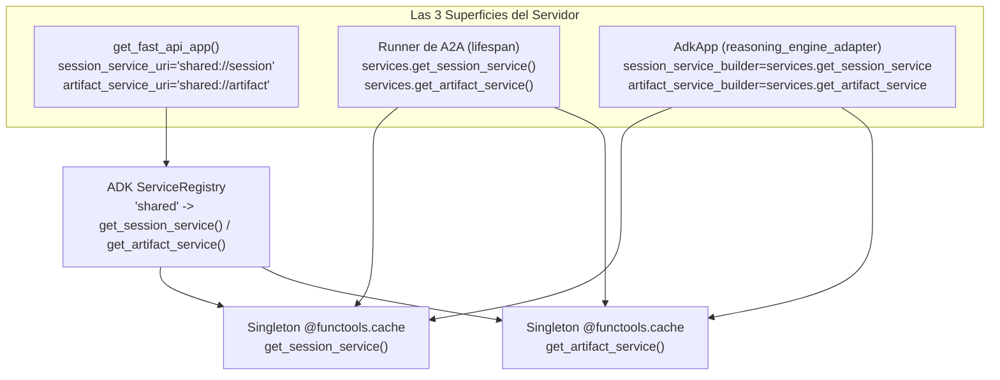
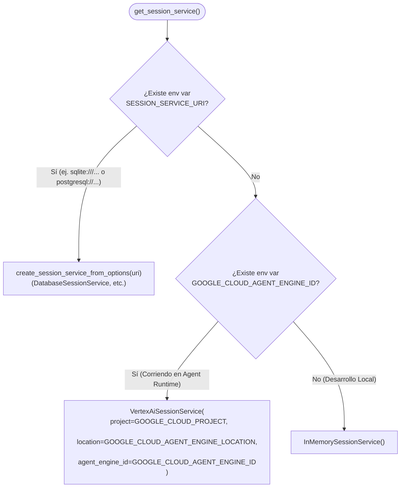

# 03 — Servicios Compartidos de Sesión y Artefactos (`app/app_utils/services.py`)

[⬅ Volver al índice de documentación](./README.md) · [⬅ Anterior: 02 — El Servidor y las 3 Superficies](./02-servidor-y-superficies-http.md)

El archivo [`app/app_utils/services.py`](../app/app_utils/services.py) resuelve dos problemas de arquitectura fundamentales en ADK:

1. **Unificar el almacenamiento entre las 3 superficies HTTP** (ADK Nativo, A2A y Reasoning Engine) dentro del mismo proceso.
2. **Conmutar automáticamente el backend de persistencia** entre el entorno local (en memoria RAM) y el entorno productivo en Google Cloud (`VertexAiSessionService` y `GcsArtifactService`) sin cambiar ni una línea en `app/agent.py`.

---

## 1. El Patrón `shared://` y el Service Registry de ADK

Si `get_fast_api_app(...)`, el `Runner` de A2A y el `AdkApp` de Reasoning Engine crearan cada uno su propio `InMemorySessionService()`, tendrías **tres diccionarios en memoria aislados**: una sesión creada desde `/apps/app/users/u1/sessions` no existiría para A2A ni para Reasoning Engine.

Para evitarlo, [`app/app_utils/services.py`](../app/app_utils/services.py#L31-L72) usa `@functools.cache` y registra el esquema personalizado `shared://` en el `ServiceRegistry` de ADK:



```python
SESSION_SERVICE_URI = "shared://session"
ARTIFACT_SERVICE_URI = "shared://artifact"

_registry = get_service_registry()
_registry.register_session_service("shared", lambda uri, **kw: get_session_service())
_registry.register_artifact_service("shared", lambda uri, **kw: get_artifact_service())
```

---

## 2. Resolución Dinámica del Backend de Sesiones ([`get_session_service`](../app/app_utils/services.py#L40-L59))

La función [`get_session_service()`](../app/app_utils/services.py#L40-L59) decide qué implementación de `BaseSessionService` usar evaluando las variables de entorno en este orden:



### ¿Cómo funciona `Session` y `State` en ADK?

Cada `Session` almacena dos cosas:
1. **`events`:** La lista inmutable de eventos (`Event`) ocurridos en la conversación (mensajes de usuario, `tool_call`, `tool_response`, respuestas del modelo).
2. **`state`:** Un diccionario mutable cuyas claves tienen **4 niveles de alcance (scopes)** según su prefijo:

| Prefijo de clave en `state` | Alcance | Ejemplo | ¿Dónde vive? |
|-----------------------------|---------|---------|--------------|
| *(Sin prefijo)* | **Sesión actual** | `state["cart_items"] = [...]` | Solo en el `session_id` actual. |
| `user:` | **Usuario (`user_id`)** | `state["user:preferred_language"] = "es"` | Compartido entre **todas las sesiones** del mismo `user_id`. |
| `app:` | **Aplicación (`app_name`)** | `state["app:announcement"] = "..."` | Compartido entre **todos los usuarios y sesiones** de la app. |
| `temp:` | **Invocación / Turno actual** | `state["temp:raw_api_payload"] = {...}` | Se descarta apenas termina el turno actual; útil para pasar datos entre un callback/tool y otro dentro del mismo turno sin persistirlos. |

---

## 3. Resolución Dinámica del Backend de Artefactos ([`get_artifact_service`](../app/app_utils/services.py#L63-L67))

```python
@functools.cache
def get_artifact_service():
    """Process-wide artifact service: GCS when a bucket is set, else in-memory."""
    if bucket := os.environ.get("LOGS_BUCKET_NAME"):
        return GcsArtifactService(bucket_name=bucket)
    return InMemoryArtifactService()
```

- **¿Para qué sirven los Artefactos (`ArtifactService`)?**
  Mientras que `session.state` está pensado para datos estructurados livianos (JSON/primitivas), `ArtifactService` almacena **archivos binarios o grandes con control de versiones automático** (`v0`, `v1`, `v2`...): PDFs, reportes CSV, imágenes generadas o audios.
- En **local** (sin `LOGS_BUCKET_NAME`), usa `InMemoryArtifactService`.
- En **Google Cloud** (donde Terraform inyecta `LOGS_BUCKET_NAME` en [`service.tf`](../deployment/terraform/single-project/service.tf)), persiste automáticamente los archivos en Google Cloud Storage (`GcsArtifactService`).

### Ejemplo de uso de Artefactos dentro de una Tool

```python
from google.adk.tools import ToolContext
from google.genai import types

async def export_report(csv_text: str, tool_context: ToolContext) -> dict:
    """Guarda un reporte CSV como artefacto versionado de la sesión."""
    part = types.Part(
        inline_data=types.Blob(
            mime_type="text/csv",
            data=csv_text.encode("utf-8"),
        )
    )
    # Sin prefijo: artefacto de la sesión actual
    # Con prefijo "user:reporte.csv": artefacto persistente entre sesiones del usuario
    version = await tool_context.save_artifact("reporte.csv", part)
    artifacts = await tool_context.list_artifacts()
    return {"saved": "reporte.csv", "version": version, "all_artifacts": artifacts}
```

---

**Siguiente lectura recomendada:** [04 — Evaluación y Testing (`tests/`)](./04-evaluacion-y-testing.md)
