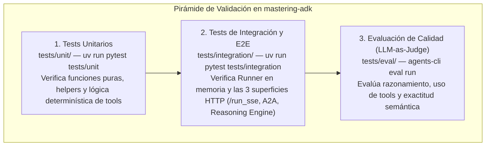
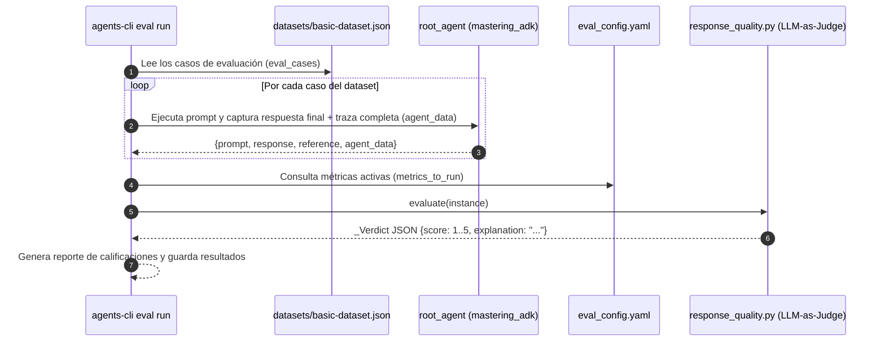

# 04 — Evaluación y Testing (`tests/`)

[⬅ Volver al índice de documentación](./README.md) · [⬅ Anterior: 03 — Servicios de Sesión y Artefactos](./03-servicios-sesion-y-artefactos.md)

En el desarrollo de agentes con ADK existe una distinción clave entre **tests determinísticos de software** (que verifican que el código, las herramientas y los endpoints HTTP funcionen sin errores) y **evaluación de calidad del agente** (que mide qué tan bien razona el LLM, qué herramientas elige y qué tan precisa es su respuesta).

El directorio [`tests/`](../tests) organiza ambas disciplinas en **tres capas complementarias**:



---

## 1. Capa 1: Tests Unitarios ([`tests/unit/`](../tests/unit))

- Archivo inicial: [`tests/unit/test_dummy.py`](../tests/unit/test_dummy.py).
- **Propósito:** Testear las funciones de tus herramientas (`get_weather`, validadores, transformaciones de datos, callbacks) de forma rápida y aislada, **sin invocar al modelo Gemini**.
- **Cómo correrlos:**
  ```bash
  uv run pytest tests/unit
  ```

### Ejemplo de test unitario para las tools de `app/agent.py`

```python
from app.agent import get_current_time, get_weather

def test_get_weather_san_francisco() -> None:
    assert "60 degrees" in get_weather("San Francisco")
    assert "90 degrees" in get_weather("Buenos Aires")

def test_get_current_time_unknown_city() -> None:
    result = get_current_time("Tokyo")
    assert "Sorry, I don't have timezone information" in result
```

---

## 2. Capa 2: Tests de Integración ([`tests/integration/`](../tests/integration))

Contiene dos archivos que prueban la ejecución real del agente de dos maneras distintas:

### A. Prueba directa en memoria con `Runner` ([`tests/integration/test_agent.py`](../tests/integration/test_agent.py))

[`test_agent_stream()`](../tests/integration/test_agent.py#L23-L57) instancia un `InMemorySessionService` y un `Runner` directamente en Python (sin levantar FastAPI ni Uvicorn) y ejecuta el agente en modo streaming (`StreamingMode.SSE`):

```python
session_service = InMemorySessionService()
session = session_service.create_session_sync(user_id="test_user", app_name="test")
runner = Runner(agent=root_agent, session_service=session_service, app_name="test")

events = list(
    runner.run(
        new_message=types.Content(role="user", parts=[types.Part.from_text(text="Why is the sky blue?")]),
        user_id="test_user",
        session_id=session.id,
        run_config=RunConfig(streaming_mode=StreamingMode.SSE),
    )
)
assert len(events) > 0
```

### B. Prueba End-to-End del Servidor HTTP ([`tests/integration/test_server_e2e.py`](../tests/integration/test_server_e2e.py))

Levanta el servidor real `uvicorn app.fast_api_app:app` en un subproceso mediante la fixture [`server_fixture`](../tests/integration/test_server_e2e.py#L111-L127), espera a que responda `/a2a/app/.well-known/agent-card.json` y ejecuta **5 tests de extremo a extremo** sobre las tres superficies HTTP:

| Test | Superficie que valida | Qué comprueba |
|------|-----------------------|---------------|
| [`test_adk_run_sse`](../tests/integration/test_server_e2e.py#L130-L171) | ADK Nativo (`/run_sse`) | Crea sesión con `state` inicial en `/apps/app/users/{id}/sessions` y consume el stream SSE en `/run_sse`. |
| [`test_a2a_chat_stream`](../tests/integration/test_server_e2e.py#L174-L206) | A2A JSON-RPC (`/a2a/app/`) | Usa el cliente oficial `a2a.client.create_client` para enviar un `SendMessageRequest` y verifica que la tarea llegue a `TASK_STATE_COMPLETED`. |
| [`test_agent_card`](../tests/integration/test_server_e2e.py#L209-L238) | A2A Discovery (`.well-known/agent-card.json`) | Verifica que la tarjeta tenga `name`, `description`, `skills`, `capabilities`, `version`, `supportedInterfaces` y la interfaz de compatibilidad v0.3. |
| [`test_reasoning_engine_stream`](../tests/integration/test_server_e2e.py#L241-L265) | Agent Runtime Async (`/api/stream_reasoning_engine`) | Invoca `class_method: "async_stream_query"` tal como lo hace Vertex AI Agent Runtime. |
| [`test_reasoning_engine_sync_stream`](../tests/integration/test_server_e2e.py#L268-L289) | Agent Runtime Sync (`/api/stream_reasoning_engine`) | Invoca `class_method: "stream_query"` para validar generadores sincrónicos en threadpool. |

---

## 3. Capa 3: Evaluación Sistemática con `agents-cli eval` ([`tests/eval/`](../tests/eval))

Mientras que `pytest` solo comprueba que el agente devuelva *algún texto* sin romperse, `agents-cli eval` evalúa **la calidad de las respuestas y las trazas de herramientas**.



### Archivos que componen [`tests/eval/`](../tests/eval)

1. **Dataset de casos ([`tests/eval/datasets/basic-dataset.json`](../tests/eval/datasets/basic-dataset.json)):**
   Define una lista `eval_cases`, donde cada caso tiene un `eval_case_id`, el `prompt` del usuario y opcionalmente un bloque `reference` (la verdad de referencia o *ground truth*, incluyendo respuestas esperadas o llamadas a tools esperadas):
   ```json
   {
     "eval_case_id": "capital_lookup",
     "prompt": {
       "role": "user",
       "parts": [{"text": "What is the capital of France?"}]
     },
     "reference": {
       "response": {
         "role": "model",
         "parts": [{"text": "The capital of France is Paris."}]
       }
     }
   }
   ```

2. **Configuración de métricas ([`tests/eval/eval_config.yaml`](../tests/eval/eval_config.yaml)):**
   Declara qué métricas correr (`metrics_to_run`) y cómo se definen las métricas personalizadas (`custom_metrics`):
   - `custom_response_quality`: delega la evaluación al archivo [`response_quality.py`](../tests/eval/response_quality.py).
   - `agent_turn_count`: métrica inline en Python que cuenta cuántos turnos tomó el agente (`len(turns)`).

3. **Evaluador LLM-as-Judge ([`tests/eval/response_quality.py`](../tests/eval/response_quality.py)):**
   - Mantiene un cliente `genai.Client()` por hilo de ejecución (`threading.local()`) para calificar múltiples casos en paralelo sin recrear conexiones TLS.
   - En [`evaluate(instance)`](../tests/eval/response_quality.py#L33-L65), arma un prompt de evaluación con la pregunta del usuario, la respuesta final del agente, la respuesta esperada (`reference`, si existe) y la traza completa (`agent_data`).
   - Usa **Structured Outputs** (`response_schema=_Verdict`, `temperature=0`) para garantizar que el modelo juez devuelva siempre un puntaje entero entre `1` y `5` junto con su explicación (`explanation`).

### Comandos principales del ciclo de evaluación

| Comando | Qué hace |
|---------|----------|
| `agents-cli eval run` | Ejecuta el agente sobre el dataset y califica todas las trazas en un solo paso. |
| `agents-cli eval metric list` | Lista las métricas predefinidas disponibles en el SDK de evaluación. |
| `agents-cli eval compare <run1> <run2>` | Compara dos corridas de evaluación para detectar regresiones tras un cambio de código o prompt. |
| `agents-cli eval analyze` | Agrupa y resume los modos de falla encontrados en los casos con bajo puntaje. |
| `agents-cli eval optimize` | Ajusta automáticamente el `instruction` del agente usando los resultados de evaluación. |

---

**Siguiente lectura recomendada:** [05 — Empaquetado, Metadatos e Infraestructura](./05-empaquetado-metadatos-e-infraestructura.md)
