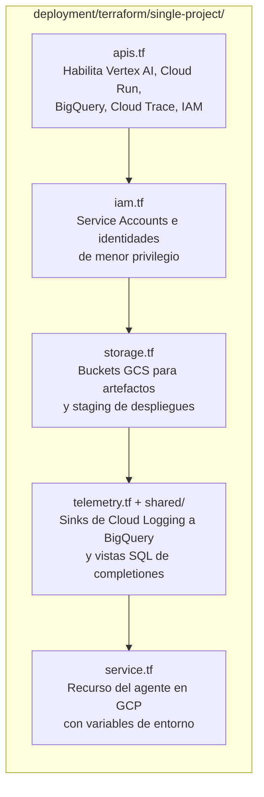
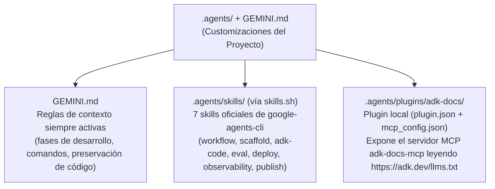

# 05 — Empaquetado, Metadatos e Infraestructura (`agents-cli-manifest.yaml`, `Dockerfile`, `deployment/`, `.agents/`)

[⬅ Volver al índice de documentación](./README.md) · [⬅ Anterior: 04 — Evaluación y Testing](./04-evaluacion-y-testing.md)

Este documento explica los archivos de control, contenedorización, infraestructura como código (Terraform) y customizaciones del asistente de IA que rodean al código de la aplicación.

---

## 1. El Manifiesto del Proyecto ([`agents-cli-manifest.yaml`](../agents-cli-manifest.yaml))

```yaml
name: "mastering-adk"
acli_version: "1.10.0"
agent_directory: "app"
region: 'us-east1'
base_template: "adk"
language: "python"
framework: "google-adk"
create_params:
  root_agent_name: "mastering_adk"
  deployment_target: "agent_runtime"
  session_type: "in_memory"
  cicd_runner: "skip"
  is_a2a: true
  agent_gateway: false
  agent_guidance_filename: "GEMINI.md"
  agent_runtime:
    identity_default: "agent_identity"
```

### ¿Para qué usa `agents-cli` este archivo?

1. **Detección del proyecto (`agents-cli info`):** Indica dónde vive el código del agente (`agent_directory: "app"`), qué plantilla base se utilizó (`base_template: "adk"`) y hacia qué destino se despliega (`deployment_target: "agent_runtime"`).
2. **Evolución sin perder cambios (`scaffold enhance` y `scaffold upgrade`):** Cuando corrés `agents-cli scaffold enhance .` (por ejemplo, para agregar CI/CD o cambiar el target a Cloud Run) o `agents-cli scaffold upgrade` (cuando sale una nueva versión de `agents-cli`), el CLI usa estos parámetros para hacer un **three-way merge** inteligente: actualiza el arnés de infraestructura conservando intacta tu lógica en `app/agent.py`.
3. **Sincronización de telemetría (`root_agent_name: "mastering_adk"`):** Debe coincidir siempre con `root_agent = Agent(name="mastering_adk", ...)` en [`app/agent.py`](../app/agent.py#L66).

---

## 2. Contenedorización con `uv` ([`Dockerfile`](../Dockerfile))

El [`Dockerfile`](../Dockerfile) empaqueta el servidor FastAPI siguiendo las mejores prácticas de `uv` para lograr builds reproducibles y rápidos:

```dockerfile
FROM python:3.12-slim

# Copia los binarios estáticos de uv y uvx desde la imagen oficial de Astral
COPY --from=ghcr.io/astral-sh/uv:0.8.13 /uv /uvx /bin/

WORKDIR /code

# Primero copia solo los archivos de dependencias para aprovechar la caché de capas de Docker
COPY ./pyproject.toml ./README.md ./uv.lock* ./

COPY ./app ./app

# Instala exactamente las versiones congeladas en uv.lock
RUN uv sync --frozen

ARG AGENT_VERSION=0.0.0
ENV AGENT_VERSION=${AGENT_VERSION}

EXPOSE 8080

CMD ["uv", "run", "uvicorn", "app.fast_api_app:app", "--host", "0.0.0.0", "--port", "8080"]
```

Este mismo contenedor sirve tanto para **Vertex AI Agent Runtime** como para **Cloud Run** o **GKE**.

---

## 3. Infraestructura como Código en GCP ([`deployment/terraform/`](../deployment/terraform))

Aunque creamos el proyecto con `--prototype` (que omite los pipelines de CI/CD multi-entorno dev/staging/prod), el template incluye en [`deployment/terraform/single-project/`](../deployment/terraform/single-project) la infraestructura Terraform lista para desplegar en un proyecto único de Google Cloud con `agents-cli infra single-project`:



| Archivo / Carpeta | Propósito |
|-------------------|-----------|
| [`apis.tf`](../deployment/terraform/single-project/apis.tf) | Habilita las APIs necesarias en GCP (`aiplatform.googleapis.com`, `logging.googleapis.com`, `cloudtrace.googleapis.com`, `bigquery.googleapis.com`, etc.). |
| [`iam.tf`](../deployment/terraform/single-project/iam.tf) | Crea las cuentas de servicio y permisos IAM para que el agente pueda invocar modelos en Vertex AI, escribir logs/trazas y acceder al bucket de artefactos. |
| [`storage.tf`](../deployment/terraform/single-project/storage.tf) | Aprovisiona el bucket GCS donde [`services.py`](../app/app_utils/services.py#L65-L66) guarda artefactos cuando `LOGS_BUCKET_NAME` está presente. |
| [`telemetry.tf`](../deployment/terraform/single-project/telemetry.tf) y [`shared/`](../deployment/terraform/shared) | Configura la exportación de trazas y logs de OpenTelemetry hacia BigQuery usando el esquema [`genai_logs_schema.json`](../deployment/terraform/shared/genai_logs_schema.json) y la consulta [`completions.sql`](../deployment/terraform/shared/completions.sql). |
| [`service.tf`](../deployment/terraform/single-project/service.tf) | Declara el recurso de cómputo del agente e inyecta las variables de entorno de producción. |
| [`vars/env.tfvars`](../deployment/terraform/single-project/vars/env.tfvars) | Variables parametrizadas del proyecto (`project_name = "mastering-adk"`, región, etc.). |

---

## 4. Customizaciones de IA a Nivel Proyecto ([`.agents/`](../.agents) y [`GEMINI.md`](../GEMINI.md))

Para que los asistentes de código (como Antigravity) conozcan tanto las reglas de este repositorio como la documentación viva de ADK sin depender de configuraciones globales de la máquina, el proyecto incluye tres elementos versionados en Git:



1. **[`GEMINI.md`](../GEMINI.md):** Se carga automáticamente como regla de proyecto y define el flujo de trabajo en 6 fases y las reglas operativas.
2. **[`.agents/skills/`](../.agents/skills) + [`skills-lock.json`](../skills-lock.json):** Contiene los 7 skills oficiales instalados localmente con `agents-cli setup --workspace --skip-auth` (usando `npx skills` / `skills.sh`). Se cargan bajo demanda (*progressive disclosure*) cuando la tarea lo requiere.
3. **[`.agents/plugins/adk-docs/`](../.agents/plugins/adk-docs):** Plugin local validado con `agy plugin validate .agents/plugins/adk-docs --strict` que conecta el servidor MCP `adk-docs-mcp` (`uvx --from mcpdoc --with "mcp<2" mcpdoc --urls AgentDevelopmentKit:https://adk.dev/llms.txt --transport stdio`) exclusivamente para este workspace.
