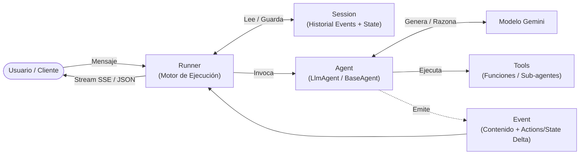
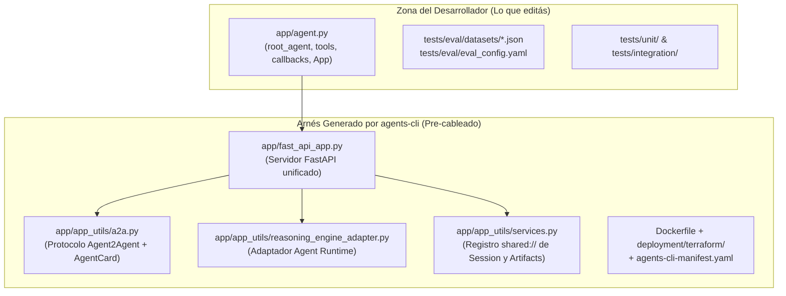

# Documentación de Arquitectura — `mastering-adk`

Bienvenido a la documentación técnica de **`mastering-adk`**. Esta guía explica qué es **Google Agent Development Kit (ADK)**, cuáles son sus primitivas fundamentales y **por qué este proyecto tiene la estructura de archivos y componentes que genera [`agents-cli`](https://google.github.io/agents-cli/)**.

---

## 1. Introducción a Google ADK

[**Google Agent Development Kit (ADK)**](https://adk.dev/) es el framework open-source de Google para diseñar, orquestar, evaluar y desplegar agentes de IA basados en modelos de lenguaje (especialmente Gemini, aunque soporta otros proveedores vía LiteLLM).

A diferencia de llamar directamente al SDK `google-genai` con `client.models.generate_content()`, ADK provee un **motor de ejecución orientado a eventos (`Runner`)** que resuelve de forma estándar el ciclo completo de un agente:

- Llamadas automáticas a herramientas (`FunctionTool`, `AgentTool`, MCP) en bucle ReAct.
- Gestión de historial conversacional y estado persistente (`Session` y `State`).
- Almacenamiento versionado de archivos binarios (`ArtifactService`).
- Orquestación multi-agente (delegación dinámica con `sub_agents` o pipelines determinísticos con `SequentialAgent`, `ParallelAgent`, `LoopAgent` y el grafo `Workflow`).
- Hooks de ciclo de vida (`Callbacks` y `Plugins`) para guardrails, observabilidad y control de ejecución.

### Las 6 Primitivas Esenciales de ADK

| Primitiva | Clase en `google.adk` | Rol en el Framework |
|-----------|-----------------------|---------------------|
| **`Agent`** | `Agent` (`LlmAgent`), `BaseAgent` | Unidad inteligente que encapsula modelo, instrucciones (`instruction`), herramientas (`tools`), callbacks y sub-agentes. |
| **`Tool`** | `FunctionTool`, `AgentTool`, `BaseTool` | Capacidad externa invocable por el modelo (funciones Python, agentes envueltos como herramientas, servidores MCP, búsqueda web). |
| **`Session`** | `Session` (`SessionService`) | Hilo conversacional con identidad (`app_name`, `user_id`, `session_id`), historial cronológico de `events` y diccionario `state`. |
| **`State`** | `session.state` (`dict`) | Memoria clave-valor asociada a la sesión (con prefijos de alcance: sin prefijo para la sesión, `user:` entre sesiones del usuario, `app:` global y `temp:` por turno). |
| **`Event`** | `Event` | Unidad atómica de comunicación emitida durante la ejecución (mensajes de usuario, llamadas a tools, respuestas del modelo y deltas de estado/artefactos en ` event.actions`). |
| **`Runner`** | `Runner` | Motor que coordina el ciclo: carga la `Session`, ejecuta el `Agent`, aplica los efectos secundarios de cada `Event` en el `SessionService` y devuelve el stream de eventos al cliente. |

---

## 2. ¿Por qué esta estructura de proyecto? (`adk` vs `agents-cli`)

Cuando empezás con ADK puro (`google-adk`), para correr un agente en tu máquina solo necesitás dos archivos (`app/__init__.py` y `app/agent.py`). Sin embargo, llevar un agente a **producción real** exige resolver cinco problemas adicionales que no pertenecen a la lógica de negocio del agente:

1. **Interoperabilidad de protocolos:** Exponer al agente simultáneamente por la API nativa de ADK, el protocolo abierto [**A2A (Agent2Agent)**](https://a2a-protocol.org/) y el contrato de **Vertex AI Agent Runtime (`reasoning_engine`)**.
2. **Estado compartido entre protocolos:** Garantizar que una sesión creada por una ruta HTTP sea visible por las demás rutas dentro del mismo proceso, y que en la nube cambie automáticamente de memoria RAM (`InMemory`) a servicios gestionados (`VertexAiSessionService` y `GcsArtifactService`).
3. **Evaluación sistemática (Quality Flywheel):** Separar los tests determinísticos de software (`pytest`) de la evaluación probabilística de calidad del agente (`agents-cli eval run` con LLM-as-judge).
4. **Observabilidad:** Trazas distribuidas OpenTelemetry hacia Cloud Trace, Cloud Logging y BigQuery.
5. **Infraestructura reproducible:** Contenedor Docker optimizado con `uv` y módulos de Terraform para IAM, buckets y despliegue en GCP.

Por eso [**Google Agents CLI (`agents-cli`)**](https://google.github.io/agents-cli/) genera esta arquitectura separando claramente **lo que vos editás** ([`app/agent.py`](../app/agent.py)) del **arnés de servidor, evaluación e infraestructura** que viene pre-cableado:

---

## 3. Índice de Documentación Detallada

Cada componente principal de la arquitectura tiene su propio documento con diagramas, explicación línea por línea y ejemplos prácticos:

1. [**01 — El Núcleo del Agente (`app/agent.py`)**](./01-nucleo-del-agente.md)
   Cómo se definen las herramientas (`FunctionTool`, `ToolContext`), el agente raíz (`root_agent`), la configuración del modelo `Gemini`, los callbacks y el contenedor `App`.
2. [**02 — El Servidor y las 3 Superficies de Entrada (`app/fast_api_app.py`, `a2a.py`, `reasoning_engine_adapter.py`)**](./02-servidor-y-superficies-http.md)
   Cómo el servidor FastAPI expone simultáneamente las rutas nativas de ADK + Playground Web, el protocolo A2A (`.well-known/agent-card.json` + JSON-RPC) y el contrato de Vertex AI Agent Runtime.
3. [**03 — Servicios Compartidos de Sesión y Artefactos (`app/app_utils/services.py`)**](./03-servicios-sesion-y-artefactos.md)
   Cómo funciona el registro `shared://session` y `shared://artifact`, cómo se comparte el estado entre protocolos, los prefijos de alcance de `state` y la transición automática entre entorno local y Google Cloud.
4. [**04 — Evaluación y Testing (`tests/`)**](./04-evaluacion-y-testing.md)
   Cómo se estructuran los 3 niveles de validación: tests unitarios, tests de integración (en memoria y servidor E2E sobre las 3 superficies HTTP) y evaluación con LLM-as-Judge (`agents-cli eval`).
5. [**05 — Empaquetado, Metadatos e Infraestructura (`agents-cli-manifest.yaml`, `Dockerfile`, `deployment/`, `.agents/`)**](./05-empaquetado-metadatos-e-infraestructura.md)
   Qué rol cumplen el manifiesto del CLI, la sincronización del nombre del agente, el `Dockerfile` con `uv`, los módulos de Terraform y las customizaciones del proyecto (`.agents/skills/` y `.agents/plugins/`).
